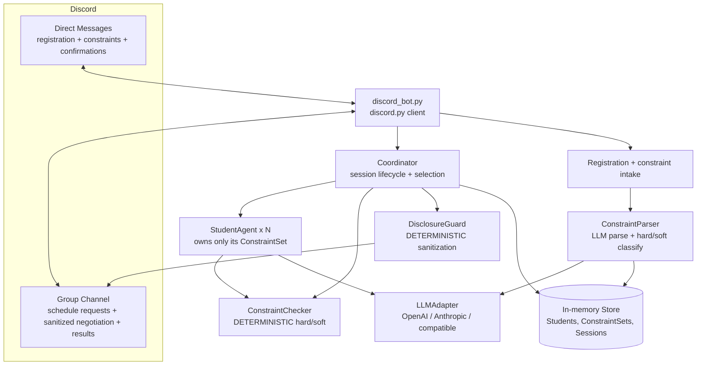
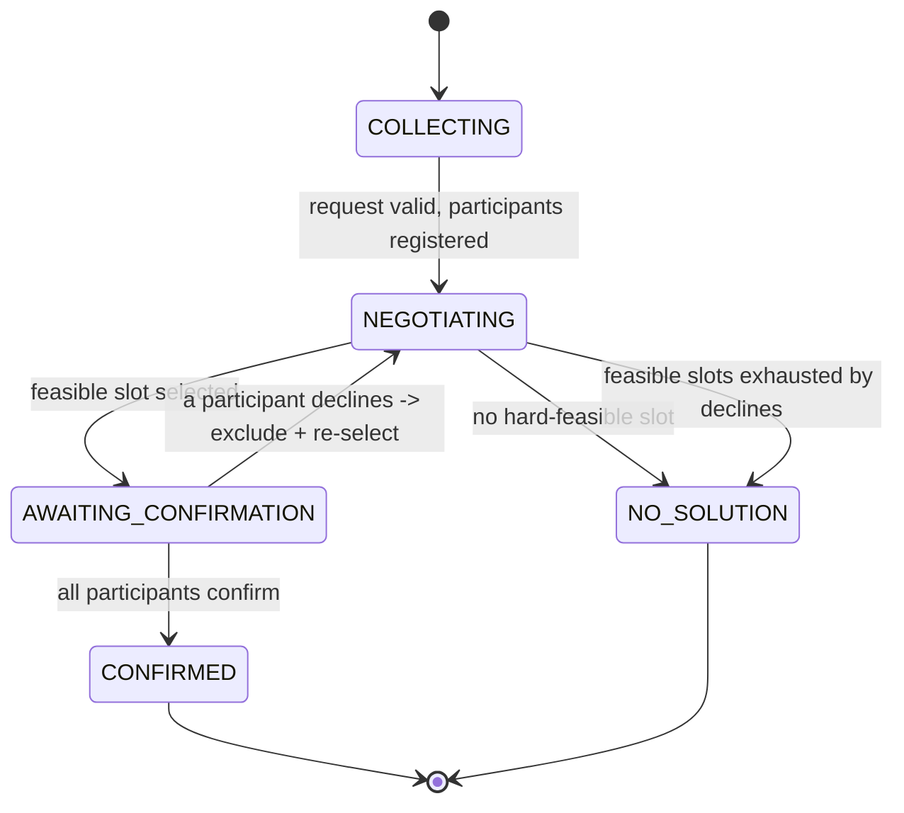

# Design Document

## Overview

HelpCircuit is a multi-agent campus scheduling assistant that runs entirely inside Discord. Each registered student is represented by a personal agent that privately holds that student's parsed scheduling constraints. When a student asks the group to find a meeting time, a coordinator routes candidate time slots to every participant's agent; the agents converge on a slot that violates nobody's hard constraints, disclose only sanitized public reasons, and ask their own human to confirm when a soft preference is the only thing in the way. All time math and hard-constraint checks are deterministic and authoritative; the LLM handles language understanding, classification, disclosure wording, and when-to-ask judgment.

This design favors a **single-process** deployment: the Discord bot imports the scheduling/agent modules directly and shares one in-memory store. This removes the two-process state-synchronization problem of a separate HTTP backend, which was the source of friction in the prior iteration (the bot and the web server each held independent state). FastAPI is no longer required and the web frontend is removed.

### Goals
- Real, dynamic Discord users (no seeded students, no web UI).
- AI that does genuinely hard work: natural-language constraint parsing, hard/soft classification, disclosure reasoning, and confirmation gating.
- A deterministic safety net that can never be overridden by the LLM.
- A small, testable codebase that runs on Windows with the existing Python 3.12 `.venv`.

### Non-goals (from requirements)
No auth beyond Discord identity, no external calendar integration, no web frontend, no payments, bounded slot grid only, small groups (min 2, best with 3+).

## Architecture



### Process model
One Python process runs the `discord.py` client. Incoming Discord events call into plain Python modules (`coordinator`, `constraint_parser`, `store`, `agents`). Because `discord.py` is async, long LLM calls are run in a thread (`asyncio.to_thread`) so the gateway heartbeat is never blocked. All shared state lives in a single in-memory `store` module (process-wide dicts). Persistence is in-memory for the demo; a note below describes the swap to SQLite if needed.

## Reuse vs. rebuild

| File | Action | Notes |
|---|---|---|
| `backend/agents/llm_adapter.py` | **Reuse** | Provider-agnostic OpenAI/Anthropic client via `.env`. Already returns parsed JSON or `None` on failure. |
| `backend/config.py` | **Reuse (extend)** | Already loads `.env` and resolves provider/model. Add `DISCORD_BOT_TOKEN` (already present) and a timezone/grid default. |
| `backend/agents/base.py` | **Reuse (adapt)** | `BaseAgent` already enforces "owns only its own private data." Repurpose to hold a `ConstraintSet` instead of slot lists. |
| `backend/constraints.py` | **Rebuild** | Becomes `ConstraintChecker` + `DisclosureGuard` for the new constraint model. |
| `backend/store.py` | **Rebuild** | Dynamic registration + sessions instead of seeded students. |
| `backend/agents/student_agent.py` | **Rebuild** | Holds a `ConstraintSet`; `evaluate(slot)`, `public_reason(...)`, confirm helpers. |
| `backend/discord_bot.py` | **Rebuild** | New commands and DM/group flows; imports coordinator directly. |
| `backend/seed.py` | **Remove** | No hardcoded students. |
| `backend/matching.py` | **Remove** | No 3-way cycle. |
| `backend/negotiation.py` | **Remove** | Replaced by `coordinator.py`. |
| `backend/chat.py` | **Remove** | Replaced by bot command handlers + coordinator. |
| `backend/main.py`, `frontend/`, `backend/smoke_test.py` | **Remove** | No web frontend/API needed (FastAPI optional). |
| `backend/tests/*` | **Replace** | New tests for the new modules. |

New files to create: `backend/models.py`, `backend/slots.py`, `backend/constraint_parser.py`, `backend/coordinator.py` (plus rebuilds above).

## Components and Interfaces

Each component is a plain Python module; the Discord bot wires them together in one process.

- **discord_bot.py** — the `discord.py` client. Translates Discord events into calls: `!register`→`store.register`, DM text→`constraint_parser.parse_and_store`, `!schedule`→`coordinator.start_session`, DM confirm reply→`coordinator.record_confirmation`. Runs LLM/coordinator calls via `asyncio.to_thread`.
- **Coordinator** (`coordinator.py`) — owns session lifecycle. Interface: `start_session(channel_id, requester_id, participant_ids, window) -> SchedulingSession`, `record_confirmation(session_id, user_id, accept: bool) -> SchedulingSession`, `status(session_id)`. Internally calls `select()`, drives state transitions, and emits sanitized group messages + confirmation DMs.
- **StudentAgent** (`agents/student_agent.py`) — represents one student; holds only its own `ConstraintSet`. Interface: `evaluate(slot) -> {feasible: bool, soft_violated: bool}` (delegates to `ConstraintChecker` on its own constraints), `public_reason(slot) -> str` (allowlisted), `confirmation_prompt(slot, soft_violated) -> str`.
- **ConstraintParser** (`constraint_parser.py`) — `parse_and_store(student, text) -> ConstraintSet`. Calls `LLMAdapter.chat_json`, validates, maps to the grid model, stores.
- **ConstraintChecker** (`constraints.py`) — deterministic authority: `violates_hard(student, slot) -> bool`, `violates_soft(student, slot) -> bool`.
- **DisclosureGuard** (`constraints.py`) — deterministic: `sanitize(text, participants) -> str`.
- **LLMAdapter** (`agents/llm_adapter.py`, reused) — `chat_json(system, user) -> dict | None`, `status()`.
- **Store** (`store.py`) — `register(user_id, name)`, `student(user_id)`, `agent(user_id)`, `session(id)`, `reset()`.
- **Slots** (`slots.py`) — `resolve_window(text|keyword) -> keyword`, `build_grid(window) -> list[Slot]`.

## Data Models

Lightweight dataclasses in `backend/models.py` (dicts are fine too; dataclasses add clarity).

```python
@dataclass
class Constraint:
    kind: str            # "hard" | "soft"
    days: list[str]      # subset of mon..sun
    start: str           # "HH:MM" inclusive
    end: str             # "HH:MM" exclusive
    note: str            # PRIVATE label, e.g. "class", "therapy" — never shared

@dataclass
class ConstraintSet:
    hard: list[Constraint]   # must never be violated
    soft: list[Constraint]   # negotiable; violate only with the student's OK

@dataclass
class Student:
    discord_user_id: int
    display_name: str
    constraints: ConstraintSet

@dataclass
class Slot:
    date: str            # "YYYY-MM-DD"
    hour: int            # 8..20 (start hour of a 1-hour block)
    # overlap is exact-block equality; two Slots equal iff same (date, hour)

@dataclass
class SchedulingSession:
    id: str
    channel_id: int
    requester_id: int
    participant_ids: list[int]
    window: str                       # resolved window keyword
    grid: list[Slot]
    state: str                        # COLLECTING | NEGOTIATING | AWAITING_CONFIRMATION | CONFIRMED | NO_SOLUTION
    excluded: set                     # (date,hour) slots removed after a decline
    selected: Optional[Slot]
    confirmations: dict               # participant_id -> True/False/None
    pending_confirm: set              # participant_ids still to answer
    log: list                         # sanitized event log for the group
```

Store (`backend/store.py`): `STUDENTS: dict[int, Student]`, `SESSIONS: dict[str, SchedulingSession]`, `AGENTS: dict[int, StudentAgent]`, plus `register(user_id, name)` and `reset()`.

### Slot grid and time-window resolution (`backend/slots.py`)
- Single fixed timezone `America/Phoenix` (reused convention).
- Day hours limited to a study range **08:00–20:00**, each a 1-hour block → 13 slots/day. Bounded and small.
- Window keywords resolve deterministically relative to "now":
  - `today` → remaining blocks today; `tomorrow` → next day; `3days` → next 3 days; `thisweek` → today through Sunday; `7days` → next 7 days (default).
  - Free-text windows ("before Friday") are mapped to one of these keywords by the LLM, with `7days` as the safe fallback.
- Grid is the ordered list of all `Slot`s in range. Grid order defines deterministic tie-breaks.

## Constraint parsing (LLM) — `backend/constraint_parser.py`

The only safety-non-critical but high-value use of the LLM for ingestion. The model converts a DM like *"class till 5 Mon/Wed, practice Tue & Thu evenings, I hate mornings"* into structured constraints and classifies each.

LLM output schema (strict JSON):
```json
{
  "constraints": [
    {"kind": "hard", "days": ["mon","wed"], "start": "08:00", "end": "17:00", "note": "class"},
    {"kind": "hard", "days": ["tue","thu"], "start": "18:00", "end": "20:00", "note": "practice"},
    {"kind": "soft", "days": ["mon","tue","wed","thu","fri","sat","sun"], "start": "08:00", "end": "10:00", "note": "dislikes mornings"}
  ]
}
```

Deterministic validation (reject malformed, keep valid):
```python
def validate(raw):
    out = []
    for c in (raw or {}).get("constraints", []):
        if c.get("kind") not in ("hard", "soft"): continue
        days = [d for d in c.get("days", []) if d in WEEKDAYS]
        if not days: continue
        if not (is_hhmm(c.get("start")) and is_hhmm(c.get("end")) and c["start"] < c["end"]): continue
        out.append(Constraint(c["kind"], days, c["start"], c["end"], str(c.get("note",""))[:60]))
    return out
```
If the LLM is unavailable or returns nothing valid, the agent DMs the student: *"I couldn't understand that — try e.g. 'busy Mon/Wed 9-5, no evenings'."* (graceful degradation; no crash).

Mapping a constraint to the grid is deterministic: a `Slot` is **hard-blocked** for a student if its weekday is in any hard constraint's `days` and `[hour, hour+1)` overlaps `[start,end)`; **soft-disfavored** likewise for soft constraints.

## Deterministic core — `backend/constraints.py`

```python
class ConstraintChecker:
    def violates_hard(self, student, slot) -> bool: ...   # final authority
    def violates_soft(self, student, slot) -> bool: ...

class DisclosureGuard:
    def sanitize(self, text, participants) -> str:
        # Remove every private note substring (case-insensitive),
        # strip raw slot ids / weekday+time patterns, and collapse any
        # decline explanation to an allowlisted public phrase.
```
Public reasons are restricted to an allowlist: hard conflict → "has a scheduling conflict"; soft → "prefers a different time". LLM-authored group text is passed through `sanitize()`; anything containing a private `note`, a raw slot id, or a time pattern is replaced. This guarantees privacy regardless of model output.

## Selection algorithm (deterministic) — in `coordinator.py`

```python
def select(session, checker, students):
    best = None
    for slot in session.grid:
        if (slot.date, slot.hour) in session.excluded: continue
        if any(checker.violates_hard(students[p], slot) for p in session.participant_ids):
            continue  # infeasible: hard conflict
        soft_hits = sum(checker.violates_soft(students[p], slot) for p in session.participant_ids)
        key = (soft_hits, session.grid.index(slot))  # fewest soft violations, then earliest
        if best is None or key < best[0]:
            best = (key, slot)
    return best[1] if best else None  # None => NO_SOLUTION
```
Reproducible: same grid + same constraint sets ⇒ same selection.

## Negotiation and confirmation flow



Flow detail:
1. **COLLECTING → NEGOTIATING.** Validate the request: ≥2 named participants, all registered (unregistered → report in group, stop). Build the grid.
2. **NEGOTIATING.** Run `select()`. Each participant's `StudentAgent.evaluate(slot)` wraps the checker so the per-agent decision is attributable (and the agent can phrase a public reason). No feasible slot → **NO_SOLUTION** with a sanitized explanation.
3. **AWAITING_CONFIRMATION.** Post the selected time to the group (sanitized). DM **every** participant a confirmation request; participants whose **soft** constraint the slot violates get a tradeoff-framed message ("you dislike mornings — OK with 8am?"). Others get a plain "confirm this time?".
4. Replies: a **yes** from everyone → **CONFIRMED**, announce the slot + participants in the group. Any **no** → add the slot to `excluded`, return to NEGOTIATING, re-select. If re-selection finds nothing → **NO_SOLUTION**.
5. Free-text replies ("sure", "can't that day") are interpreted to yes/no by the LLM, with a deterministic yes/no/y/n and ✅/❌ fast path.

This single AWAITING_CONFIRMATION phase satisfies both the soft-constraint ask (Req 9) and the everyone-confirms-to-commit rule (Req 10).

## Discord interaction design — `backend/discord_bot.py`

Requires the **Message Content intent** (enabled in the Developer Portal and in code: `intents.message_content = True`). DMs and guild text channels are both handled.

Commands (prefix `!`, configurable):
- `!register` — in DM or group; creates the `Student` keyed by `discord_user_id`, then the bot DMs the user asking for their schedule.
- *(DM free text)* — treated as constraint intake → parsed, stored, and the bot DMs back a plain-language summary of what it understood (full detail is OK here: it's a private DM to the owner).
- `!mytimes` — DM only; the bot shows the owner their parsed constraints.
- `!schedule @a @b @c [window]` — in the group channel; `window` is one of `today|tomorrow|3days|thisweek|7days` (default `7days`), or a free-text phrase mapped by the LLM. Mentions give participant `discord_user_id`s directly.
- `!status` — show the current session state in the channel.
- Confirmation — handled by DM replies (`yes`/`no`/free text) to the bot.

Privacy separation is structural: constraint intake and confirmations happen **only** in DMs, so raw schedules never touch the group channel; everything posted to the group passes through `DisclosureGuard`.

Mapping: a Discord user maps to a `Student` purely by `discord_user_id`. Unregistered mentioned users are reported and block the session until they `!register`.

## Where the LLM is used (and where it is not)

Used by the LLM (language + judgment):
1. **Constraint parsing + hard/soft classification** (`constraint_parser.py`).
2. **Disclosure wording** of group messages (then always `sanitize()`d).
3. **Human-readable negotiation/confirmation phrasing** in DMs and group posts.
4. **Interpreting free-text confirmation replies** → yes/no (deterministic fast path first).

Never the LLM (deterministic, authoritative):
- Slot-grid generation, overlap math, hard/soft feasibility, slot selection, state transitions, and the privacy guarantee in `DisclosureGuard`.

## Error handling
- LLM call failure / malformed JSON → `LLMAdapter` returns `None`; parser asks the student to rephrase; confirmation interpretation falls back to the deterministic yes/no parser. The scheduling core keeps working on already-stored constraints.
- Unregistered participant → reported in group; session not started.
- `<2` participants → rejected with a message.
- Discord API errors on DM (e.g., DMs disabled) → the bot posts a non-private nudge in the group asking that user to enable DMs/`!register`.

## Security and privacy
- Private constraint data is captured and echoed back only in DMs, stored per `discord_user_id`, and readable only by that student's own agent.
- Every group-channel-bound string passes through `DisclosureGuard.sanitize()`.
- No authentication beyond Discord identity (explicit non-goal); the bot trusts Discord's authenticated user ids.
- Secrets (`DISCORD_BOT_TOKEN`, LLM key) come from `.env`, which is git-ignored.

## Testing strategy
Unit/integration tests run with the LLM **disabled/mocked** so they are deterministic:
- `test_slots.py` — grid generation and window resolution are correct and reproducible.
- `test_constraints.py` — `ConstraintChecker` hard/soft feasibility; `DisclosureGuard` never leaks a private `note`, raw slot id, or weekday/time pattern.
- `test_constraint_parser.py` — with a `FakeLLM` returning JSON: valid constraints map to the right blocked/disfavored slots; malformed entries are dropped.
- `test_coordinator.py` — selection picks fewest soft violations with grid-position tie-break; state transitions; a confirmation **decline** excludes the slot and re-selects; all-hard-infeasible → NO_SOLUTION; everyone-confirms → CONFIRMED.
- `test_end_to_end.py` — scripted 3-participant scenario with one soft-constraint confirmation, asserting the confirmed slot and that no private data appears in group-bound output.

Manual: a live Discord run with 2–3 real accounts following the demo script.

## Files to create / modify (smallest set)
Create: `backend/models.py`, `backend/slots.py`, `backend/constraint_parser.py`, `backend/coordinator.py`.
Rebuild: `backend/constraints.py`, `backend/store.py`, `backend/agents/student_agent.py`, `backend/agents/base.py`, `backend/discord_bot.py`, `backend/tests/*`, `README.md`, `.env.example`.
Remove: `backend/seed.py`, `backend/matching.py`, `backend/negotiation.py`, `backend/chat.py`, `backend/main.py`, `backend/smoke_test.py`, `frontend/`.
Reuse unchanged: `backend/agents/llm_adapter.py`, `backend/config.py` (minor extension).

## Correctness Properties

These invariants must hold regardless of LLM behavior and are covered by tests:

### Property 1: Hard-constraint safety
No session ever reaches CONFIRMED with a `selected` slot that `ConstraintChecker.violates_hard` reports true for any participant. (Authoritative deterministic check.)
**Validates: Requirements 8.1, 8.2, 8.4, 11.1, 11.3**

### Property 2: Privacy
No string posted to the group channel contains any participant's private constraint `note`, a raw slot id, or a weekday/time pattern — `DisclosureGuard.sanitize` is applied to all group-bound text, including LLM-authored text.
**Validates: Requirements 7.2, 7.3, 7.4, 3.5, 6.3**

### Property 3: Determinism of selection
Given the same grid and the same participant `ConstraintSet`s and `excluded` set, `select()` returns the same slot (fewest soft violations, then earliest grid position).
**Validates: Requirements 5.4, 5.5, 5.6, 11.4**

### Property 4: Single valid state
Every session holds exactly one `Session_State`; transitions follow the state diagram; CONFIRMED and NO_SOLUTION are terminal.
**Validates: Requirements 13.1, 13.7**

### Property 5: Confirmation completeness
CONFIRMED requires a recorded `yes` from every participant for the currently selected slot; any `no` excludes that slot and forces re-selection or NO_SOLUTION.
**Validates: Requirements 10.2, 10.3, 10.4, 9.4**

### Property 6: Agent isolation
A `StudentAgent` reads only its own `ConstraintSet`; the coordinator never reads another student's private constraints except through that student's agent/checker call.
**Validates: Requirements 3.4, 11.2**

### Property 7: Graceful degradation
If `LLMAdapter` is unavailable, parsing and free-text confirmation report a clear message and the deterministic core (checker, selection, state machine) still functions on stored data.
**Validates: Requirements 12.4, 12.5**

## Requirements traceability
- R1 Registration → `store.register`, `!register`.
- R2 Discord-only → bot is sole interface; FastAPI/frontend removed.
- R3 NL constraint intake via DM → `constraint_parser` + DM handler; per-agent private storage.
- R4 Group request + bounded grid → `!schedule`, `slots.build_grid`, ≥2 participant check.
- R5 Agent-to-agent convergence → `coordinator.select` + `StudentAgent.evaluate`.
- R6 Honest no-solution → NO_SOLUTION path + sanitized explanation.
- R7 Selective disclosure → `DisclosureGuard`, public-reason allowlist.
- R8 Hard constraints absolute → `ConstraintChecker.violates_hard` authoritative; LLM overridden.
- R9 Soft-constraint confirmation → tradeoff DM in AWAITING_CONFIRMATION.
- R10 Everyone confirms → confirmations dict → CONFIRMED.
- R11 Deterministic authority → checker/selection/guard are code; LLM only for language/judgment.
- R12 Provider-agnostic LLM via .env → reused `LLMAdapter`/`config`.
- R13 State machine → `SchedulingSession.state` transitions as diagrammed.
- R14 Campus value → DM-private intake + quick convergence + ask-only-on-tradeoff.
- R15 Non-goals → no auth/calendar/frontend/payments; bounded grid; min 2 participants.
```
